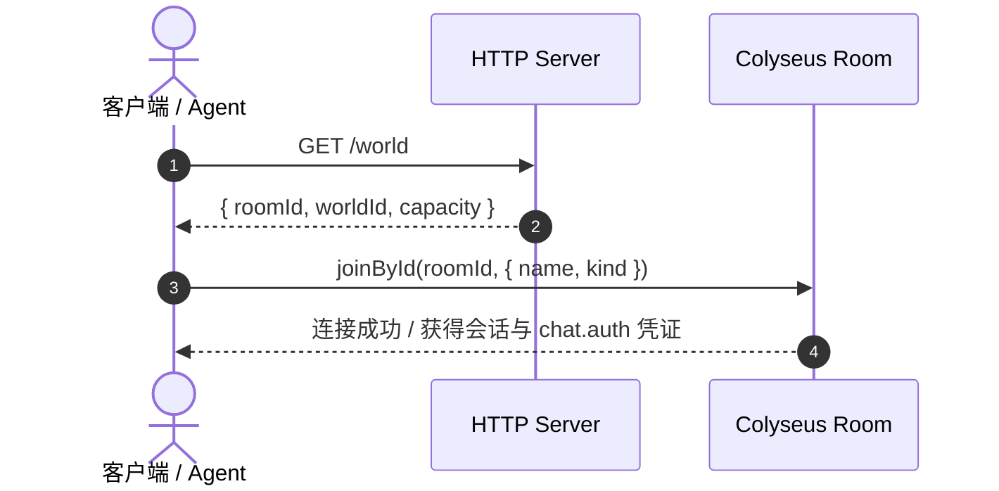
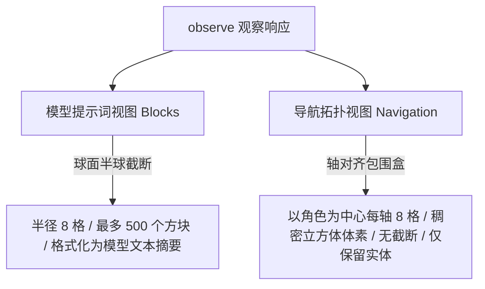
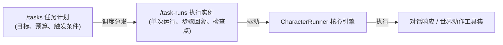

# 协议与扩展边界

本文档系统梳理 Agent Voxel World 的网络通信协议、权威物理与动作规范、空间感知边界、状态持久化机制以及聊天协议。

::: tip 协议架构原则

- **世界权威协议**：通过 Colyseus WebSocket 维护房间状态与 20Hz 权威物理模拟。
- **Agent 管理协议**：独立于世界协议，统一采用携带 Bearer 令牌的 REST/WebSocket 网关（详见 [Agent Gateway](/agent/gateway.md)）。
  :::

---

## 房间入房与大厅感知

客户端进入世界的标准流程如下：



1. **获取房间 ID**：客户端发起 `GET /world`，获取当前唯一可用世界的 `roomId`。
2. **Colyseus 入房**：使用 Colyseus JS 0.16 发起 `joinById(roomId, { name, kind })`。
   - `kind: "scripted-agent"`：脚本驱动代理身份（在界面标注，无特权）。
   - `kind: "ai-agent"`：托管 AI 智能体身份（在界面标注，无特权）。
   - 其他或缺省值：一律按真人玩家（`human`）处理。

::: info 安全与部署边界
当前原型阶段不提供第三方全局身份鉴权，默认仅监听本机或受信任内网。生产环境部署请务必在前置网关配置访问控制。
:::

### 大厅实时 Presence（SSE 订阅）

客户端无需加入房间即可感知世界大厅活跃状态。

- **接口端点**：`GET /world/presence`
- **通信模式**：Server-Sent Events (SSE) 单向流。
- **生命周期**：连接建立后立即推送一次全量状态，随后每秒推送一次心跳增量。退出游戏后订阅仍可独立保留。

#### 数据包结构与字段规范

| 字段名               | 类型                    | 说明                                                                 |
| :------------------- | :---------------------- | :------------------------------------------------------------------- |
| `worldId` / `roomId` | `string`                | 世界唯一标识与 Colyseus 房间标识                                     |
| `revision`           | `number`                | 当前世界全局方块修改版本号                                           |
| `capacity`           | `number`                | 房间最大容纳人数                                                     |
| `persistence`        | `string`                | 数据持久化状态摘要                                                   |
| `updatedAt`          | `number`                | 服务端生成快照的时间戳                                               |
| `players`            | `Array<PresencePlayer>` | 活跃玩家数组（`id`、`name`、`kind`、`position`、`yaw`、`connected`） |

::: warning 状态与跨域约定

- **在线人数统计**：仅计算 `connected === true` 的玩家，真人与代理分别计数；断线重连宽限期内的玩家标为“重连中”，不计入活跃人数。
- **跨域限制**：接口严格限制仅配置的 `WEB_ORIGIN` 允许访问。世界未就绪时返回 `503 Service Unavailable`。
- **心跳容错**：客户端断线或 5 秒未收到心跳将数据标记为陈旧，2 秒后自动重试；无有效数据时界面应展示“未知”，禁止降级显示为 0。
  :::

---

## 权威白名单动作

所有客户端向世界发出的主动交互均封装为房间消息 `action`：

```typescript
interface ActionMessage {
  id: string; // 动作唯一 ID，最大 80 字符，用于结果溯源与关联
  type: string; // 动作类型（白名单校验）
  payload: object; // 动作载荷
}
```

### 频率限制与安全配额

- **普通动作与同步**：每个连接每秒最多 **45 次** 请求（超过将丢弃或返回限流）。
- **单包体积上限**：WebSocket 单个数据包最大 **16 KB**。

### 动作指令全集

| 动作类型 (`type`)     | 载荷参数 (`payload`)                                                                  | 执行机制与服务端返回                                                                              |
| :-------------------- | :------------------------------------------------------------------------------------ | :------------------------------------------------------------------------------------------------ |
| **`move`**            | `{ x, z, jump, yaw }`<br>方向分量取值范围 `[-1, 1]`                                   | 20Hz 服务端权威物理与碰撞模拟。不发送单帧 ACK，客户端直接消费房间状态同步；250ms 无输入自动制动。 |
| **`edit`**            | `{ x, y, z, material, revision }`<br>`material`: `grass`/`dirt`/`stone`/`wood`/`null` | 乐观并发修改方块（`null` 表示摧毁）。成功后广播 `edit` 事件并推进全局 `revision`。                |
| **`chat`**            | `{ text, scope?, recipients? }`<br>字符长度限制 `1..240`                              | 支持 `public`（公开）与 `private`（私聊）。私聊仅投递给指定会话，广播带过滤机制。                 |
| **`observe`**         | `{}`                                                                                  | 返回结构化感知快照 `observation`（包含角色自身、周围实体、附近方块、全局版本与可用动作）。        |

### 版本控制与乐观并发冲突（CAS）

1. **版本推进**：每次成功的 `edit` 都会递增世界全局 `revision`，广播携带新版本号。
2. **并发冲突**：多个客户端同时基于同一版本提交编辑时，仅首个写入成功，其余客户端将收到 `conflict` 错误响应并附带最新 `snapshot`。
3. **版本跳跃检测**：客户端若收到非连续的 `revision`，会自动请求 `sync` 重新拉取完整世界快照，避免出现渲染空洞或幽灵方块。客户端不会自动盲目重放破坏性编辑。

---

## 空间导航与观察边界

为了兼顾大语言模型（LLM）的上下文窗口开销与本地精确寻路的需求，系统设计了**分层感知模型**：



### 感知维度对比

| 特性维度       | 模型认知视图 (`blocks`)           | 导航寻路拓扑 (`navigation`)                                    |
| :------------- | :-------------------------------- | :------------------------------------------------------------- |
| **感知范围**   | 球形半球，半径 8 格               | 闭区间整数立方体包围盒（以坐标取整为中心，各轴向外延展 8 格）  |
| **截断规则**   | 最多截取 **500 个方块**           | **完整返回** 包围盒内所有实体方块，严格不发生截断              |
| **空气解释**   | 隐式忽略                          | 包围盒内缺席的坐标单元明确代表空气（可通行体素）               |
| **模型可见性** | 格式化拼装进 System / User Prompt | **不进入模型上下文**，仅供客户端及 Agent Runtime 本地 A\* 寻路 |
| **运动反馈**   | 不携带底层物理参数                | 携带瞬时物理状态 `motion: { grounded: boolean, vy: number }`   |

::: info 宏动作执行约定
Agent 的 `goto` 与 `follow` 属于 Agent Runtime 的客户端复合宏动作，而非服务端底层协议原生写入操作。最终底层依然分解为高频的 `move` 动作指令，接受服务端的碰撞与重力约束。
:::

---

## 状态持久化与断线恢复

### 数据库 CAS 架构

服务端使用 PostgreSQL + Prisma 进行多粒度状态持久化：

```
+-------------------------------------------------------+
|  World 表: [ worldId, revision, updatedAt ]            |
|    |                                                  |
|    +-- BlockEdit 表: [ worldId, x, y, z, material ]    |
|        (仅记录对程序化基础地形的增量覆盖修改)             |
+-------------------------------------------------------+
```

- **增量存储**：仅将玩家手动放置或破坏的体素存入 `BlockEdit`（`material === null` 表示挖掘清除原有地形）。
- **原子事务**：每次编辑都在单次 Prisma 事务内执行：
  1. 对 `World.revision` 执行条件匹配检查（CAS）；
  2. 原子写入/更新 `BlockEdit` 记录；
  3. 递增版本号；
  4. 提交成功后才更新服务内存并向房间广播。若事务失败返回 `storage-unavailable`，内存世界保持不变。

### 客户端会话重连机制

- **令牌保管**：客户端入房成功后将 `reconnectionToken` 缓存在当前标签页的 `sessionStorage`。
- **宽限期**：页面刷新或瞬间弱网断线时，客户端凭借该令牌可免握手快速恢复会话。
- **超时回收**：窗口关闭或断线持续达 **20 秒** 后，服务端判定会话终结并清理 Avatar。
- **服务重启**：若服务端进程重启，旧重连令牌自动失效，客户端自动重新加入世界并拉取数据库全量还原的基准快照。

---

## 聊天协议

### 消息范围与权限模型

聊天支持两种范围：

1. **公开聊天 (`public`)**：全服广播，无特殊限制。
2. **私信聊聊 (`private`)**：必须提供 `1..8` 个互不重复、当前在线且非发送者自身的玩家会话 ID。私聊数据仅发向目标玩家，房间其他玩家及未授权 Agent 的 `observe` 无法获取该记录。

### 凭证安全验证（`chat.auth`）

客户端入房或重连成功时，服务端下发一次性临时凭证：

```json
{
  "type": "chat.auth",
  "payload": {
    "token": "eyJhbGciOi..."
  }
}
```

- **用途**：Floperati 分支已移除语音栈，当前没有 `/chat/*` HTTP 路由；令牌仅保留以维持客户端协议兼容。
- **令牌实效性**：玩家退出房间或会话重置后令牌立即作废。严禁将该 Token 放入 URL 查询参数。

## 托管 Agent 任务控制协议

Agent 运行时的任务调度模型严格划分为**计划调度层（Plan）**与**执行生命周期层（Run）**：



### 任务控制端点全集

| 端点路径                 | 请求方法        | 权限层级      | 业务功能说明                                            |
| :----------------------- | :-------------- | :------------ | :------------------------------------------------------ |
| `/tasks`                 | `GET`           | 管理员 Bearer | 分页检索全局任务计划，支持按角色与状态筛选              |
| `/tasks`                 | `POST`          | 管理员 Bearer | 创建并立即排队一项新的 Agent 任务计划                   |
| `/tasks/:id`             | `GET` / `PATCH` | 管理员 Bearer | 查询或更新任务计划的配置、预算与优先级                  |
| `/task-runs`             | `GET`           | 管理员 Bearer | 检索特定任务计划的历史运行实例列表                      |
| `/task-runs/:id/control` | `POST`          | 管理员 Bearer | 对执行中的实例下发 `pause`、`resume`、`cancel` 控制指令 |

::: warning 协议废弃提醒
旧版本中的 `/ai-characters/:id/task`、`/ai-characters/:id/pause`、`/ai-characters/:id/resume` 等旧接口已彻底移除。所有任务编排必须通过全局统一的 `/tasks` 与 `/task-runs` 端点管理。
:::
